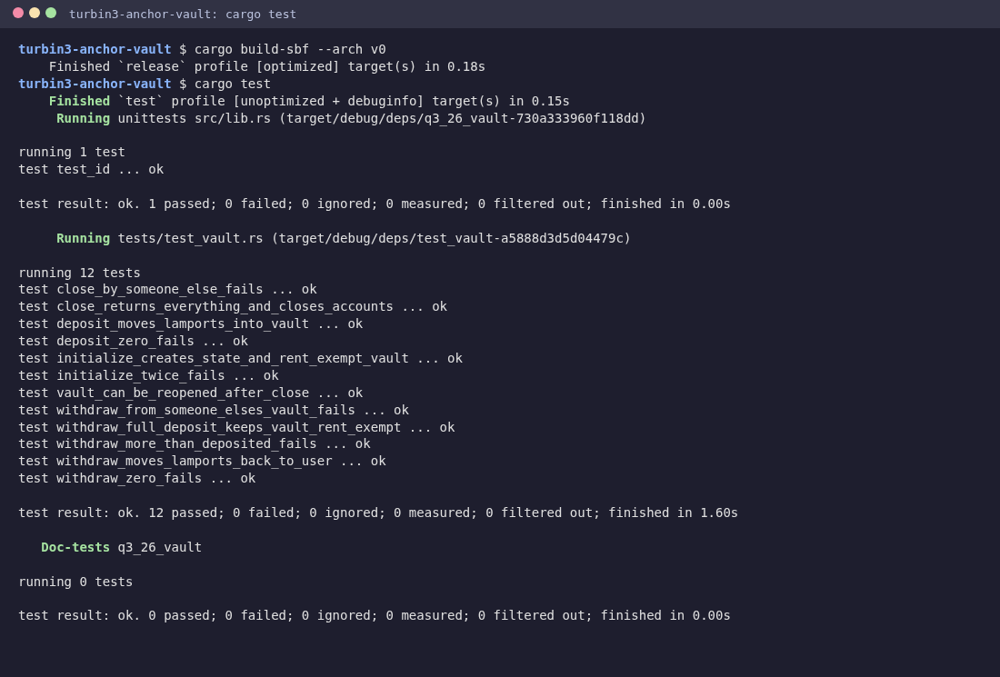

# turbin3-anchor-vault

A SOL vault program on Solana, written in Anchor for Week 2 of the Turbin3 Builders Cohort.

Each wallet gets its own vault. I can open it, deposit SOL, withdraw part of it, and close it to get everything back, including the rent. The SOL never sits in an account I control directly: it lives in a PDA that only the program can sign for, and the program only signs when the vault's owner asks.

## Accounts

```
              seeds = ["state", user]                 seeds = ["vault", user]
 user ───────► vault_state (program-owned) ──bumps──► vault (system-owned PDA)
 (signer)       { vault_bump, state_bump }             holds the deposited SOL
```

| Account | Type | Seeds | Owner | Purpose |
|---|---|---|---|---|
| `user` | `Signer` | – | System | Pays for the state account, deposits and receives SOL |
| `vault_state` | `Account<VaultState>` | `["state", user]` | This program | Stores both bumps so later instructions don't re-derive them |
| `vault` | `SystemAccount` | `["vault", user]` | System program | Holds the lamports; the program signs for it with its seeds |

The vault is a plain system account with no data. That keeps transfers simple (`system_program::transfer` with PDA signer seeds), and it's why `initialize` funds it with the rent-exempt minimum for a 0-byte account up front.

## Instructions

| Instruction | Args | What it does |
|---|---|---|
| `initialize` | – | Creates `vault_state`, stores both bumps, and moves the rent-exempt minimum into `vault` |
| `deposit` | `amount: u64` | Transfers `amount` lamports from the user to the vault (CPI, user signs) |
| `withdraw` | `amount: u64` | Transfers `amount` lamports from the vault back to the user (CPI, vault PDA signs with `["vault", user, bump]`) |
| `close` | – | Sends every lamport in the vault back to the user and closes `vault_state` with `close = user`, refunding its rent too |

## Security checks

- **Per-user PDAs.** Both PDAs are derived from the signer's key, so passing someone else's `vault_state` or `vault` fails with `ConstraintSeeds`. There is no way to withdraw from or close another user's vault.
- **Stored bumps.** `deposit`, `withdraw` and `close` check the PDAs against the bumps saved in `vault_state`, so only the canonical addresses are accepted.
- **No overdrawing.** `withdraw` only allows the balance above the rent-exempt floor. Asking for more fails with `InsufficientFunds`, so a withdraw can never leave the vault below rent exemption. Draining it fully is what `close` is for.
- **No zero amounts.** `deposit` and `withdraw` reject `0` with `InvalidAmount`.
- **Clean close.** `close` empties the vault (the runtime then garbage-collects the 0-lamport system account) and Anchor's `close = user` zeroes and reclaims `vault_state`. The same user can open a fresh vault again afterwards.

## Build and test

Requirements: Rust (the repo pins 1.89.0 in `rust-toolchain.toml`), the Solana CLI (I used Agave 4.3.1) and optionally Anchor CLI 1.1.2.

```bash
git clone https://github.com/viraj-mahida/turbin3-anchor-vault.git
cd turbin3-anchor-vault

# build the program to target/deploy/q3_26_vault.so
cargo build-sbf --arch v0

# run the LiteSVM tests (they load the .so from target/deploy)
cargo test
```

`anchor test --skip-build` runs the same two steps through the script in `Anchor.toml` (a plain `anchor build` uses the default SBPF v3 target, which LiteSVM 0.10 can't load).

> **Why `--arch v0`?** Agave 4.x defaults `cargo build-sbf` to SBPF v3. LiteSVM 0.10 can't load a v3 binary yet (`add_program` fails with `InvalidAccountData`), so I build for v0, the most widely supported target.

The tests are in Rust with [LiteSVM](https://github.com/LiteSVM/litesvm), in [`programs/q3_26_vault/tests/test_vault.rs`](programs/q3_26_vault/tests/test_vault.rs). Each test spins up a fresh in-process SVM, so they're fast and independent.

| Test | Checks |
|---|---|
| `initialize_creates_state_and_rent_exempt_vault` | State is program-owned, vault holds exactly the rent-exempt minimum |
| `initialize_twice_fails` | The state account can't be re-initialized |
| `deposit_moves_lamports_into_vault` | Vault balance goes up by the deposit |
| `deposit_zero_fails` | `InvalidAmount` |
| `withdraw_moves_lamports_back_to_user` | Vault goes down and the user goes up by the amount (minus the tx fee) |
| `withdraw_full_deposit_keeps_vault_rent_exempt` | Withdrawing everything deposited leaves the rent reserve |
| `withdraw_more_than_deposited_fails` | `InsufficientFunds` |
| `withdraw_zero_fails` | `InvalidAmount` |
| `withdraw_from_someone_elses_vault_fails` | `ConstraintSeeds`, victim's balance unchanged |
| `close_returns_everything_and_closes_accounts` | Both accounts gone, user receives deposit + both rent reserves |
| `close_by_someone_else_fails` | `ConstraintSeeds`, state still exists |
| `vault_can_be_reopened_after_close` | Initialize + deposit work again after a close |



## What I learned

- **A PDA can hold SOL without holding data.** The vault is a system-owned account at a program-derived address. The program can't "own" it in the data sense, but it can sign transfers out of it with `CpiContext::new_with_signer` and the seeds plus bump. That signature is the whole security model.
- **Rent is part of the balance.** A system account must stay rent-exempt or go to exactly zero. That's why `initialize` pre-funds the vault, `withdraw` only lets me take what's above the floor, and `close` takes everything at once.
- **Store bumps once.** Saving the bumps in `vault_state` during `initialize` means every later instruction does a cheap `create_program_address` check instead of a `find_program_address` loop.
- **`close = user` does three things.** It moves the lamports, reassigns the account to the system program and wipes its data, which stops anyone from reviving the account with stale state.
- **LiteSVM makes testing fast.** No validator, no airdrop waits: I load the compiled `.so`, set balances directly and assert on exact lamport amounts, including the 5,000-lamport signature fee.

## Where this applies

This pattern is the base of most DeFi programs: a program-controlled account that only releases funds under rules the code enforces. Savings vaults, payroll or allowance wallets, DAO treasuries and staking pools all start from the same "PDA holds funds, program signs for it" shape.
